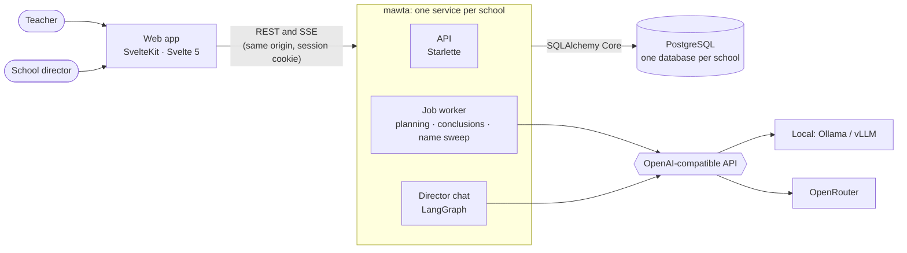

# Mawta

**An open-source gradebook for Peruvian schools, where AI drafts and the teacher decides.**

[](https://github.com/amaru-one/mawta/actions/workflows/ci.yml)
[](LICENSE)


In Peru, teachers assess every student by competency, following the national curriculum (CNEB).
Each term they:
- plan learning experiences;
- collect evidence;
- assign each student an achievement level (AD, A, B or C);
- write a descriptive conclusion for each level.

Mawta keeps all of that in one place, and puts AI agents next to the teacher to do the drafting.

This repository is the backend: one Python service per school. It holds the API, the job worker,
the agents, the director's chat, and the database schema with its migrations.

## AI that proposes, never decides

Every agent in Mawta drafts something a person reviews. Nothing is saved on the teacher's
behalf, every claim points to the data it rests on, and no agent ever sets a grade.

| Agent | What it drafts | Its guardrail |
|---|---|---|
| **Planning** | A learning experience built from the teacher's idea and the CNEB: evaluation criteria, planned evidence and a session outline | It cites only the curriculum the school has loaded. Proposals stay pending until the teacher accepts them. It receives no student data |
| **Descriptive conclusions** | A student's descriptive conclusion (*conclusión descriptiva*) for one competency and term: progress, difficulties and recommendations | Every point must cite the evidence or voice note it rests on. The level belongs to the teacher, who sets it first |
| **Name sweep** | Every person mentioned in a voice-note transcript, misspellings and nicknames included | The names are replaced before any other agent reads the note |
| **Director chat** | Answers to the school leadership's questions, in Spanish: achievement levels, students at risk, promotion projections, one student's history | A LangGraph agent with six read-only SQL tools. Tables come straight from the database, never retyped by the model |

## Built for local models

Every agent talks to an OpenAI-compatible API, and each one picks its model with a single
variable, `provider:model`:

```sh
PLANNING_AGENT_MODEL=local:gemma4:12b-it-qat     # Ollama on a laptop, or Ollama/vLLM on a school's GPU server
REDACTION_AGENT_MODEL=local:qwen3:4b              # a small model is enough for the name sweep
CHAT_MODEL=openrouter:openai/gpt-oss-120b         # or a hosted open model through OpenRouter
```

The goal is that a school can run Mawta on hardware it controls, with open models and no
per-question subscription. An agent without a model is simply unavailable, and the teacher works
by hand. The public demo uses OpenRouter, which also transcribes the voice notes (Whisper).

## Domain rules as tested code

The chat's definitions live inside its tools, not in a prompt:
- what counts as "at risk";
- how a streak of C levels in one competency is counted;
- who would go to recovery under the national promotion rules (RVM 048-2024).

Each rule has its own test case. The tools are also checked against a demo school whose expected
answers are written down in advance.

## Architecture



- **One school, one database.** No row names its school: the `school` table holds exactly one
  row. A `pg_dump` backs up a whole school, the chat's memory included.
- **One process.** The API, the worker and the chat run in the same service and share the
  session cookie. A director's chat is just another route under `/api/v1/chat/`.
- **The chat's boundary is in the database.** The chat's tools run their SQL as the role
  `mawta_chat`, which can read only the `chat_api` views. The app reaches that role with
  `SET LOCAL ROLE` inside the transaction, so a tool cannot see the rest of the tables even if
  the model asks it to. Row-level security also keeps each director's chats private.
- **The schema is Python.** The tables are typed SQLAlchemy models. Functions, triggers, views and
  policies are [alembic_utils](https://github.com/olirice/alembic_utils) entities. The Alembic
  migrations are generated from them and checked in CI ([docs/schema.md](docs/schema.md)).
  Queries use SQLAlchemy Core, not an ORM.

## Repository layout

| Path | What is inside |
|---|---|
| `src/main.py`, `web.py`, `settings.py`, `db.py`, `errors.py`, `applog.py` | App factory, configuration, transactions and logging |
| `src/routes/`, `src/repo/` | HTTP handlers, and their queries in SQLAlchemy Core (one module per area) |
| `src/auth/`, `src/authz.py` | Sessions, and the guards for each class and role |
| `src/agent/`, `src/worker/`, `src/stt.py`, `src/media.py` | The agents, the Postgres-backed job queue, speech-to-text and ffmpeg |
| `src/chat/` | The director chat: graph, tools, SSE protocol, routes ([docs/director-chat.md](docs/director-chat.md)) |
| `src/mawta_schema/` | The database schema in Python |
| `migrations/` | Alembic |
| `src/onboarding/`, `src/curriculum/`, `src/cli/`, `onboarding/` | The school installer, the CNEB catalog (data), the `onboard` and `useradd` commands, and the onboarding template |
| `tests/` | pytest against a real Postgres: the API, `tests/chat/` and `tests/schema/` |

The web app, the deployment and the demo school live in their own repositories.

## Running it locally

You need Docker, [`uv`](https://docs.astral.sh/uv/) and `ffmpeg`. For local models you also need
[Ollama](https://ollama.com). The steps:

1. Start Postgres and migrate it ([docs/local-postgres-setup.md](docs/local-postgres-setup.md)).
2. Install a school from its JSON file ([docs/school-onboarding.md](docs/school-onboarding.md)).
3. Copy `.env.example` to `.env` and pick a model for each agent and for the chat.
4. Start the app:

   ```sh
   uv sync
   uv run mawta                  # HTTP_ADDR, default :8080; the worker runs in the same process
   curl localhost:8080/healthz
   ```

| Command | What it does |
|---|---|
| `uv run mawta` | The server, plus the worker when `WORKER_ENABLED` (the default) |
| `uv run alembic upgrade head` | Migrates the database in `MAWTA_MIGRATIONS_URL` (or `ADMIN_DATABASE_URL`) |
| `uv run onboard -file colegio.json [-dry-run]` | Installs a whole school. `-sync -modular <code> -grado 1S=1S` updates its curriculum |
| `uv run useradd -username … -role teacher\|director …` | Creates one account, or resets its password with `-reset-password` |

The image (`Dockerfile`) has the same commands. Its default command is `mawta`, and it also
contains `alembic.ini` and `migrations/`.

## Tests

```sh
uv run ruff check . && uv run ruff format --check .
uv run pyright
MAWTA_TEST_ADMIN_URL=postgres://postgres:<password>@127.0.0.1:5432/postgres uv run pytest -rs
```

The tests create and drop their own databases. They migrate them with Alembic and load the test
school from `tests/fixtures.py`. The chat's tests replace the model with a scripted fake, so no
test ever calls a provider. Without `MAWTA_TEST_ADMIN_URL` the database tests are skipped, and
`-rs` shows them. CI fails if any test is skipped.

## Logging

The app writes one JSON object per line to stdout, always with `service: "mawta-server"`. The
events are:
- `http.request`: one per request, with `request_id`, `route`, `status` and `duration_ms`;
- `worker.job_started` and `worker.job_outcome`;
- `stt.usage` and `agent.usage`.

No entry contains passwords, cookies, API keys, audio, transcripts or student data. Request
bodies are logged only through the opt-in `REQUEST_BODY_CAPTURE` allowlist.

## Status

Mawta is in active development. It runs as a demo with a fictional school. The teacher workflow
is in place: planning, evidence, levels and conclusions. So is the first version of the director
chat.

## License

[MIT](LICENSE) © 2026 The Mawta Authors
