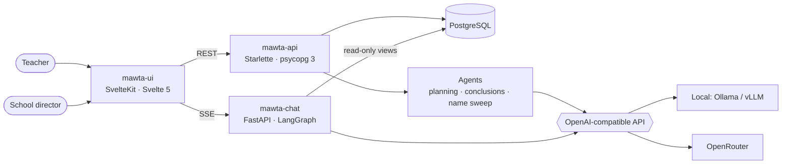

# Mawta

**An open-source gradebook for Peruvian schools, where AI drafts and the teacher decides.**

[](https://github.com/amaru-one/mawta/actions/workflows/ci.yml)
[](LICENSE)


Teachers in Peru assess every student by competency, following the national curriculum
(CNEB): they plan learning experiences, collect evidence, assign an achievement level
(AD, A, B or C) each term and write a descriptive conclusion for each one. Mawta keeps all
of that in one place, and puts AI agents next to the teacher to do the drafting.

## AI that proposes, never decides

Every agent in Mawta drafts something a person reviews. Nothing is saved on the teacher's
behalf, every claim points to the data it rests on, and no agent ever sets a grade.

| Agent | What it drafts | Its guardrail |
|---|---|---|
| **Planning** | A learning experience from the teacher's idea and the CNEB: evaluation criteria, planned evidence and a session outline | Cites only the curriculum the school has loaded; proposals stay pending until the teacher accepts them; it receives no student data |
| **Descriptive conclusions** | A student's conclusión descriptiva for one competency and term: progress, difficulties and recommendations | Every point must cite the evidence or voice note it rests on; the level is the teacher's and is set first |
| **Name sweep** | Finds every person mentioned in a voice-note transcript, misspellings and nicknames included | Names are replaced before any other agent reads the note |
| **Director chat** | Answers the school leadership's questions in Spanish: achievement levels, students at risk, promotion projections, one student's history | A LangGraph agent with six read-only SQL tools; tables come straight from the database, never retyped by the model |

## Built for local models

Every agent talks to an OpenAI-compatible API, and each one picks its model with a single
variable, `provider:model`:

```sh
PLANNING_AGENT_MODEL=local:gemma4:12b-it-qat     # Ollama on a laptop, or Ollama/vLLM on a school's GPU server
REDACTION_AGENT_MODEL=local:qwen3:4b              # a small model is enough for the name sweep
CHAT_MODEL=openrouter:openai/gpt-oss-120b         # or a hosted open model through OpenRouter
```

The goal is that a school can run Mawta on hardware it controls, with open models and no
per-question subscription. The public demo uses OpenRouter, and voice-note transcription
(Whisper) currently goes through OpenRouter as well.

## Domain rules as tested code

The chat's definitions live inside its tools, not in a prompt: what counts as "at risk", how
a competency streak is counted, or who would go to recovery under the national promotion
rules (RVM 048-2024). Each rule has its own test case, and the tools are checked against a
demo school whose expected answers are written down in advance.

## Architecture



- **`mawta-api`** — the app's API, hand-written SQL (no ORM), an in-process job queue that
  runs the agents, and row-level security that scopes every query to one school.
- **`mawta-chat`** — the director's chat as a separate service; its database role can only
  read the `chat_api` views.
- **`mawta-ui`** — the web app for teachers and school leadership, on desktop and mobile.
- **`deploy`** — Docker Compose and Caddy for the demo server; GitHub Actions builds,
  migrates and deploys on every merge to `main`.

## Repository layout

| Path | What is inside |
|---|---|
| [`mawta-api/`](mawta-api/README.md) | Python 3.14 API, agents, migrations (`goose`), school onboarding |
| [`mawta-chat/`](mawta-chat/README.md) | The director's chat service and its tools |
| [`mawta-ui/`](mawta-ui/README.md) | SvelteKit 2 + Svelte 5 + TypeScript UI |
| [`deploy/`](deploy/) | Production Compose file, Caddy and observability (Grafana, Loki, Alloy) |

## Running it locally

You need Docker, [`uv`](https://docs.astral.sh/uv/) and, for local models,
[Ollama](https://ollama.com).

1. Start Postgres and apply the migrations: [`mawta-api/docs/local-postgres-setup.md`](mawta-api/docs/local-postgres-setup.md).
2. Install a school: [`mawta-api/docs/school-onboarding.md`](mawta-api/docs/school-onboarding.md).
3. Copy `mawta-api/.env.example` to `mawta-api/.env` (and, for the chat,
   `mawta-chat/.env.example` to `mawta-chat/.env`) and pick a model for each agent.
4. Run the stack:

   ```sh
   docker compose -f docker-compose.local.yml up --build                    # API + UI
   docker compose -f docker-compose.local.yml --profile chat up --build     # + director chat
   ```

A one-command local setup is on the way.

## Status

Mawta is in active development and runs as a demo with a fictional school. The teacher
workflow (planning, evidence, levels and conclusions) and the first version of the director
chat are in place; next come charts in the chat, an evaluation suite for the chat's answers,
and the one-command local setup.

## License

[MIT](LICENSE) © 2026 The Mawta Authors
